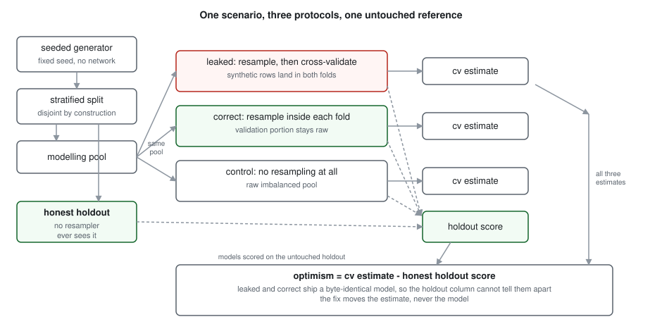
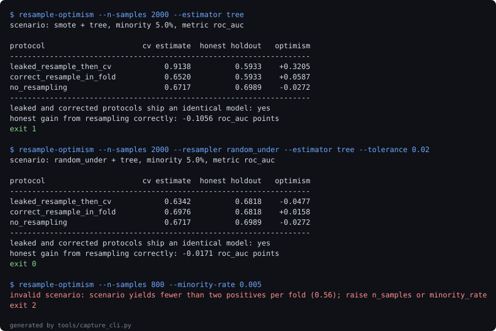

# resample-optimism

**Measures how far a cross-validation score drifts from the truth when resampling escapes the fold, and shows that the fix changes the number without changing the model.**

[](https://github.com/jayanthkodamachili/resample-optimism/actions/workflows/ci.yml)


## What a cross-validation score cannot tell you

Four questions this answers that a CV score structurally cannot:

1. Whether the number describes the model you are about to ship, or a different one.
2. How much of the number came from synthetic rows being scored against the rows they were interpolated from.
3. Whether the leak matters for your model, given that the same mistake is nearly free for a linear model and ruinous for a tree.
4. Whether the resampling step that caused all this was earning its place to begin with.

The first question is the one that makes this hard. Resampling an imbalanced training set is correct at fit time and wrong at estimate time, and in code the two look identical. A pipeline that resamples the whole pool and then cross-validates it fits exactly the same final model as one that resamples inside each fold. Only the score moved. No amount of staring at the score reveals that, because the score is the thing that is wrong.

## The numbers

Over 10 seeds, SMOTE and a random forest at 5 percent minority:

- The leaked protocol **reports 0.9979** ROC-AUC. The model it ships **scores 0.8739** on a holdout no resampler has touched. That gap is **+0.1240 points** of pure estimation error, against **-0.0164 points** for the corrected protocol.
- Both protocols shipped a byte-identical model in **10 of 10 seeds**, verified by hashing their predictions. The fix moves the estimate and never the model.
- **The uncomfortable one:** once the leak is removed, correct resampling does not pay for itself. Under average precision it improved **0 of 12 cells** swept across three estimators and four imbalance ratios, with **48 of 60** individual runs getting worse. Under ROC-AUC on the identical cells, **9 of the same 12** improve. The two metrics disagree on the sign, and the average precision loss is **6.7 times** the size of the ROC-AUC gain.

90 tests, 100 percent line coverage, and every figure above is re-measured by CI from the experiments rather than typed into this file. `tools/check_numbers.py` fails the build if any of them drifts.

## Quickstart

Requires Python `3.11` or newer. No credentials, no network at runtime, no downloads.

```bash
pip install -e ".[dev]"

# the headline comparison, a few seconds
resample-optimism --estimator tree

# everything: lint, suite, re-measure all four experiments, check the prose
make verify
```

`make verify` re-runs the experiments from scratch, which takes minutes rather than seconds. `make receipts-fast` reuses the committed experiment JSON for local iteration.

## The claim, one section at a time

### The leak is worth ten points of ROC-AUC, and it is invisible

| protocol | cv estimate | honest holdout | optimism |
| --- | --- | --- | --- |
| leaked: resample, then cross-validate | 0.9979 | 0.8739 | +0.1240 |
| correct: resample inside each fold | 0.8575 | 0.8739 | -0.0164 |
| control: no resampling | 0.8311 | 0.8458 | -0.0146 |

Read the middle column. The leaked and corrected rows are identical there, because they are the same model. A team that fixes this bug will watch its headline metric fall by twelve points and will have improved nothing about the system, which is exactly why the bug survives code review: fixing it looks like a regression.

The corrected protocol is mildly pessimistic, as it should be. Each fold trains on four fifths of the pool, so it measures a slightly weaker model than the one eventually shipped.

### Leak severity tracks row dependence, not resampling

The usual advice, never resample before splitting, is too coarse. What leaks is dependence between rows, and resamplers differ in how much they create.

| resampler | what it emits | leaked cv | optimism |
| --- | --- | --- | --- |
| random oversampling | exact duplicates | 1.0000 | +0.1169 |
| SMOTE | interpolations of near neighbours | 0.9975 | +0.1156 |
| ADASYN | interpolations, density weighted | 0.9978 | +0.1170 |
| random undersampling | nothing new | 0.8414 | -0.0222 |

Random oversampling before the split reports **a perfect 1.0000**: every validation row has its own duplicate sitting in the training fold. Undersampling before the split, by contrast, measures **-0.0222 for undersampling**, which is to say it does not meaningfully leak at all. It discards majority rows and invents nothing, so there is no dependence to exploit. The rule worth carrying is about generated rows, not about resampling.

### The same mistake costs one team nothing and another team a third of its metric

| estimator | leaked cv | honest holdout | optimism |
| --- | --- | --- | --- |
| decision tree | 0.9774 | 0.6559 | +0.3215 |
| k nearest neighbours | 0.9877 | 0.7534 | +0.2343 |
| random forest | 1.0000 | 0.8831 | +0.1169 |
| logistic regression | 0.8466 | 0.8371 | +0.0095 |

A duplicated row only inflates a score if the model can recognise it. An unpruned tree stores it in a leaf and costs **+0.3215 points**; a logistic regression has twenty coefficients and nowhere to put it, so the same protocol error comes **to +0.0095 for logistic**, a factor of **33.9 times** smaller. This is the practical finding: whether this bug is an emergency or a footnote depends on the model, and a blanket rule tells you neither.

### Having fixed it, was the resampling worth doing?

What it costs against what it buys, measured on a holdout neither arm has seen:

| metric | cells improved | runs that got worse | grand mean |
| --- | --- | --- | --- |
| average precision | 0/12 cells | 48 of 60 runs | -0.0460 |
| ROC-AUC | 9 cells improve | 20 of 60 runs | +0.0069 |

Under average precision the resampling never paid for itself in any cell: a grand mean of **-0.0460**, and the worst cell loses **-0.1063**, a forest at 2 percent minority. Under ROC-AUC the same sweep mostly improves, and gains **+0.0069** on average.

The honest reading is that the answer depends on the metric, and that the loss under the metric better suited to imbalanced problems is **6.7 times larger** than the gain under the one that is not. For the scenarios in this repository, the fix this tool teaches is a fix to a step that probably should not be in the pipeline. The first version of this experiment reported average precision alone and would have published the stronger claim without noticing the disagreement.

## The bugs the measurement found

**A single seed would have published the opposite conclusion.** The first run of the headline scenario gave a resampling benefit of about minus one point, suggesting SMOTE hurt. Averaged over ten seeds the same scenario gives a small positive. The per-seed spread of optimism is larger than several of the differences the experiments report, so every figure in this README is a mean over seeds and the spread is in the experiment JSON next to it.

**The checker's formatter was inferring from names.** `display_strings` originally chose a number's format by looking for substrings like "benefit" in the metric name. Two metrics did not contain the words it looked for, so a ratio published as `6.7000` and a signed mean lost its sign, and the anchors still matched because the anchors were built from the same broken formatter. Formatting is now declared per metric in an explicit set, which is the kind of change that makes a checker worth having.

**`make test` failed in a clean clone while `python -m pytest` passed in the same directory.** The Makefile called a bare `pytest`, which resolved to a console script belonging to a different interpreter than the one holding the editable install, so the suite could not import the package it was testing. The symptom, `ModuleNotFoundError`, points at a missing dependency and the cause was a PATH resolution order. Every target now runs through one `$(PYTHON)`. This is the bug that justifies the clone-and-verify step: nothing in the development directory could have surfaced it.

**Three defensive branches were unreachable and untested.** Coverage sat at 98 percent, and the gap was the `raise` in each factory function for a value the frozen config should already have rejected. Reaching them required `object.__setattr__` to smuggle a bad value past validation, which confirmed they really were unreachable through the public API. They stay, because the alternative to an explicit raise is a function that returns `None` into a pipeline.

## Architecture



Generated by `tools/render_diagram.py` and committed, rather than drawn in a fence. CI regenerates it and fails if the committed copy has drifted.

## Evidence



A replay of real stdout, captured by `tools/capture_cli.py` at generation time, showing a leak detected (exit 1), an undersampling run that does not leak (exit 0), and a scenario rejected before any modelling (exit 2). Every command and the exit code it actually returned are listed in [docs/evidence-manifest.json](docs/evidence-manifest.json).

## The fixture

There is no committed dataset. Scenarios come from a seeded generator, and that is a deliberate trade recorded in [ADR-002](docs/adr/ADR-002-generated-fixture-over-public-dataset.md): a public imbalanced dataset has an unknown true boundary, so the honest holdout score it yields is itself an estimate, and the optimism measured against it would mix two errors.

The awkward cases the generator is set up to produce, rather than the easy ones:

- Minority rates down to 2 percent, where a stratified fold holds few enough positives that variance dominates.
- Two clusters per class, so the minority class is not a single blob and SMOTE interpolates between genuinely separated groups.
- One percent label flip noise, so no model can reach a perfect score honestly and a near perfect CV number is always evidence of something wrong.
- A logistic regression in the estimator sweep specifically because it is the case where the leak nearly vanishes, which is the result that complicates the headline.

## What this cannot measure

Its own section, because these are the limits a reviewer should know before trusting anything above.

- **Synthetic data only.** Optimism on real data depends on the geometry of the real minority class. The leak mechanism is structural and would transfer; the magnitudes would not. No figure here should be quoted as "SMOTE costs twelve points" about any real dataset.
- **Threshold-free metrics only.** Both metrics rank predictions. Resampling is often defended on recall at a fixed threshold, and that defence is untested here. This is the single claim that genuinely needs a real dataset with a real cost matrix, and it is the Pivot below.
- **No calibration measurement.** Resampling distorts predicted probabilities by construction. This repository does not quantify that, so it cannot say whether correct resampling is harmless for a ranking task and harmful for a pricing one.
- **The identical-model claim depends on a seeded resampler.** It holds for every resampler shipped here. A resampler drawing from an unseeded source would break it, and the fingerprint test would catch that.
- **Declared, not observed:** that the generator's distribution resembles any production problem. It is a modelling assumption, not a measurement.
- **A measured zero is not a zero.** The headline that no cell improved under average precision rests on twelve cell means of five seeds each. A cell cannot resolve an effect smaller than its own seed-to-seed spread, and twelve of the sixty individual runs did improve. What the sweep supports is that twelve cells agree in sign, not that resampling can never help a single case. Separating a small genuine gain from noise in any one cell would need considerably more seeds than five.
- **The per-seed spread is wide.** In the headline scenario the leaked protocol's optimism spans **0.1601 across seeds**, which is larger than several of the differences the sweeps report. The means are stable over 10 seeds; individual cells are noisier than their means suggest, which is why the minimum and maximum for every cell are in the JSON.

See [ADR-005](docs/adr/ADR-005-what-this-cannot-measure.md).

## Layout, exit codes and reproduction

```
src/resample_optimism/
  config.py       frozen scenario, rejects folds too thin to score
  generate.py     seeded generator and the disjoint pool/holdout split
  protocols.py    the three protocols, deliberately not deduplicated
  optimism.py     estimate minus honest score, plus the fingerprint comparison
  cli.py          exit codes that carry the result
experiments/      four experiments, each writing JSON to docs/experiments
tools/            metric collection, the number checker, diagram and capture
docs/adr/         five decision records
```

| exit code | meaning |
| --- | --- |
| 0 | the audit ran and the optimism is within tolerance |
| 1 | the audit ran and found a leak above tolerance |
| 2 | the scenario was rejected before any modelling |
| 3 | the audit itself failed to complete |

Codes 0 and 1 both mean the tool worked. Only 2 and 3 mean it did not. A tool that returns zero whenever it managed to run is useless in a pipeline, because the interesting outcome is not that the audit completed.

| target | what it does |
| --- | --- |
| `make lint` | ruff |
| `make test` | suite with a coverage floor |
| `make experiments` | re-runs all four, rewriting their JSON |
| `make figures` | regenerates the diagram and the captured session |
| `make receipts` | re-measures every figure, then checks the prose |
| `make verify` | lint, test, receipts |

The number checker matches anchor phrases rather than bare digits, in both directions. Forward, every metric must appear in a checked document using its anchor wording, so a figure that drifts breaks the build. Backward, every decimal in the prose must correspond to a metric, so a number nothing re-measures cannot take up residence. Digits alone would be useless: a search for a small integer matches a version string and half the list items on the page, and a search for the right digits passes happily in a sentence that has gone stale around them.

Both directions are needed, and proving it is easy. Change one figure in the README alone and the forward check still passes, because the defense guide carries the same figure and an anchor is satisfied by any checked document. The reverse check is what catches it. Change it in both and the forward check fires too. Try it before trusting any number here.

## Stack

| technology | role | why here |
| --- | --- | --- |
| scikit-learn | estimators, folding, metrics | the folding semantics are the subject, so they have to be the ones people actually use |
| imbalanced-learn | resamplers and the fold-aware pipeline | its `Pipeline` is the fix being measured; reimplementing it would measure the wrong thing |
| numpy | fingerprints, aggregation | hashing rounded probabilities needs a stable byte representation |
| pytest with coverage floor | the suite | the central claim is asserted by a test, so the suite failing has to fail the build |
| ruff | lint | one tool for both lint and import order keeps CI to a single step |
| plain SVG, hand written | the diagram | eleven boxes that will not grow, against a Mermaid fence GitHub sometimes declines to render |

## Decision records

1. [ADR-001: three protocols as duplicated functions, not one parameterised path](docs/adr/ADR-001-duplicated-protocols.md)
2. [ADR-002: a generated fixture rather than a public imbalanced dataset](docs/adr/ADR-002-generated-fixture-over-public-dataset.md)
3. [ADR-003: scikit-learn and imbalanced-learn rather than a hand rolled resampler](docs/adr/ADR-003-boring-libraries.md)
4. [ADR-004: a committed SVG rather than a Mermaid fence](docs/adr/ADR-004-committed-svg.md)
5. [ADR-005: what this repository deliberately cannot measure](docs/adr/ADR-005-what-this-cannot-measure.md)

## The Pivot

Threshold-dependent evaluation is deliberately out of scope. Recall at a fixed operating point, cost-weighted thresholds and calibration curves are where resampling's defenders make their case, and this repository does not test it.

The trigger for adding it: the moment anyone uses these results to argue against resampling in a system that makes hard decisions at a threshold. At that point the threshold-free measurement here is the wrong evidence, and the answer needs a real dataset with a real cost matrix.

Future work, in order:

- Recall and precision at fixed operating points, with a cost matrix as input.
- A calibration measurement, since resampling distorts probabilities by construction and nothing here prices that.
- Grouped data, where the unit of resampling and the unit of observation differ and the leak gets a second route in.
- A real tabular credit or fraud dataset, to see which of these magnitudes survive contact with a real minority class.
- First metric to watch on any of these: whether the identical-model property still holds, because every other result here depends on it.

